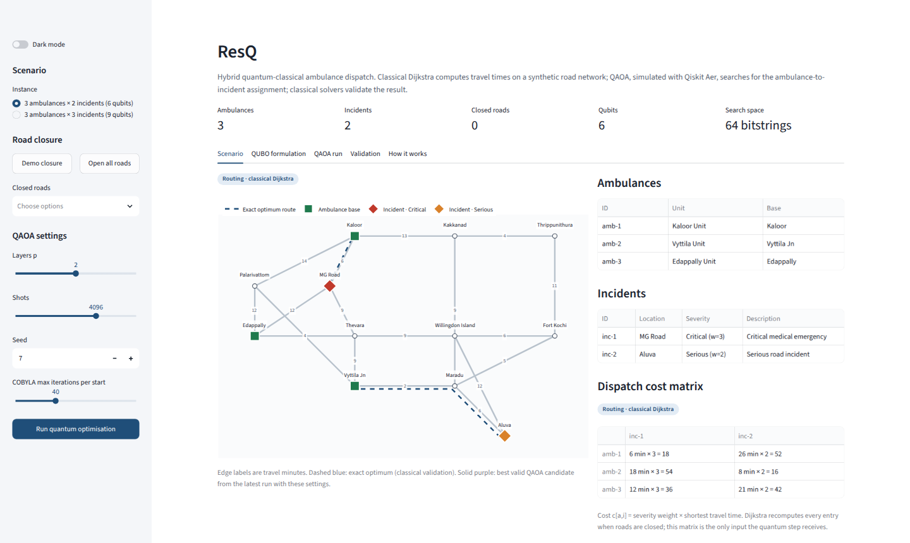
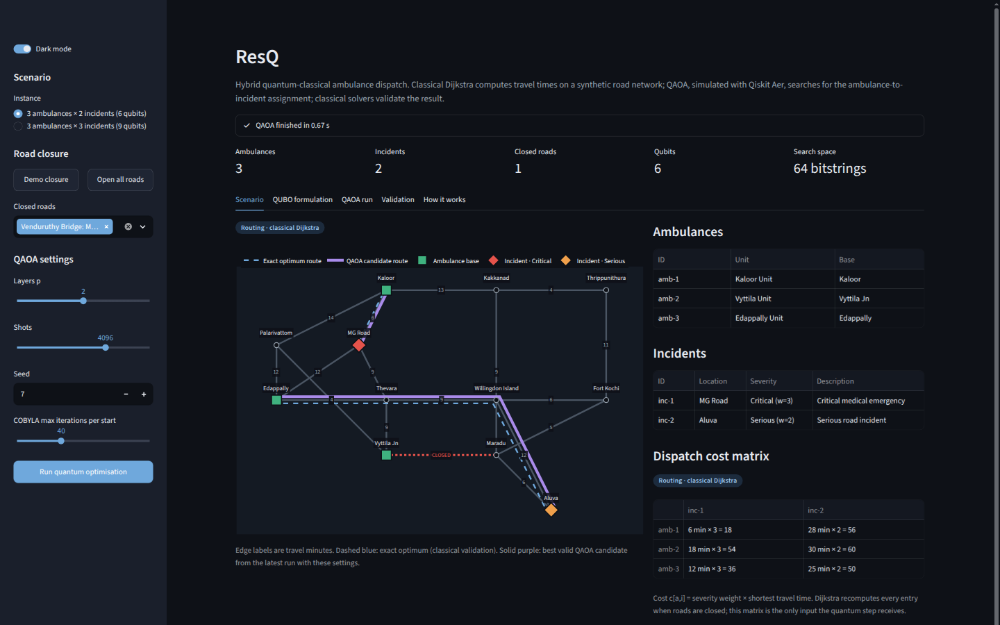
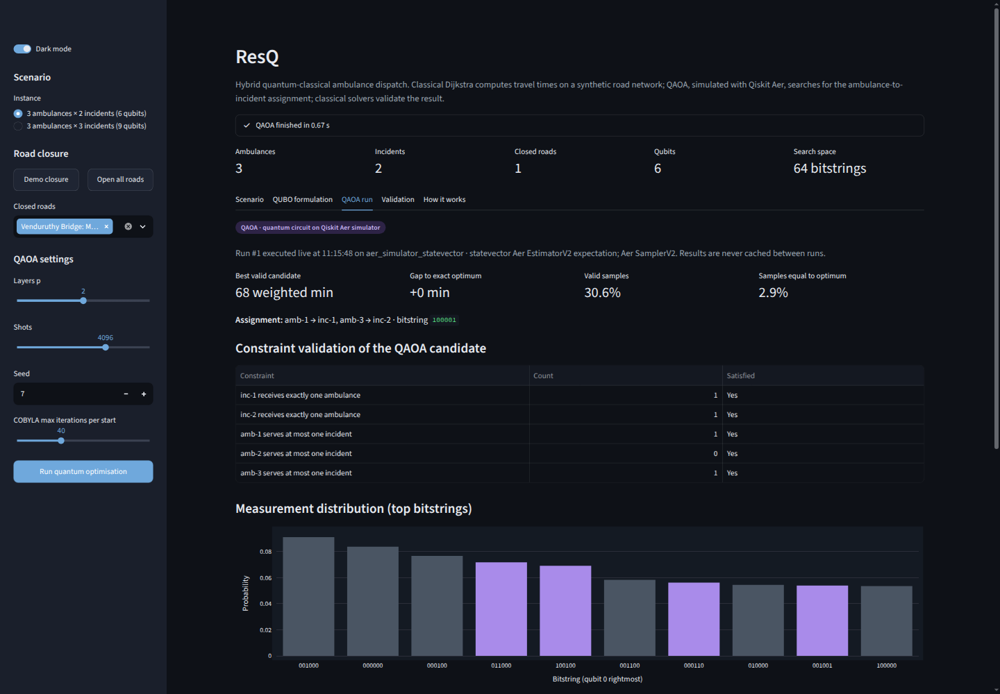
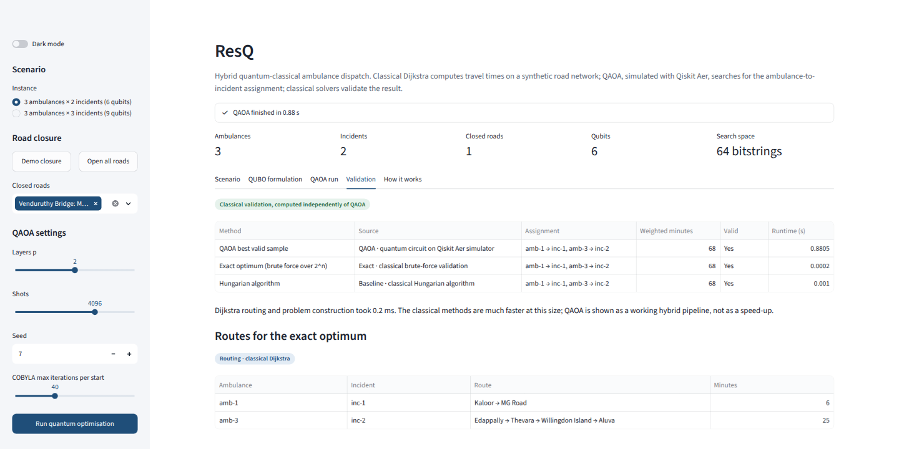

# ResQ

Hybrid quantum-classical ambulance dispatch on a synthetic Kochi road network, with QAOA (Qiskit Aer) choosing the ambulance-to-incident assignment and exact and classical solvers checking it.

[](https://github.com/slothrulez/q-rescue/actions/workflows/tests.yml)



## How it works

1. **Build the travel-cost matrix.** Dijkstra computes shortest travel times on the synthetic road graph. Each ambulance–incident cost is severity multiplied by travel time, in weighted minutes.
2. **Encode the assignment as a QUBO.** Binary variables represent reachable ambulance–incident pairs; penalty terms enforce one ambulance per incident and at most one incident per ambulance:
   `E(x) = Σ ĉ[a,i]x[a,i] + PΣ_i(1−Σ_a x[a,i])² + PΣ_aΣ_{i<j}x[a,i]x[a,j], where P = 1 + Σ_i max_a ĉ[a,i]`. See the [full formulation](docs/FORMULATION.md).
3. **Search with QAOA on Aer.** QAOA uses COBYLA to optimize a seeded circuit with `p` cost-and-mixer layers, then samples candidate assignments on the Qiskit Aer simulator.
4. **Check the candidates classically.** The program checks assignment constraints and compares against exact brute-force enumeration of all `2^n` QUBO states and the Hungarian algorithm.

QAOA performs the assignment only; shortest-path routing and route construction remain classical.

## Demo scenario

With all roads open, the exact optimum is **34 severity-weighted minutes**. Closing Venduruthy Bridge (Vyttila Jn–Maradu) raises it to **68 weighted minutes**; `amb-3` takes over the Aluva incident via Thevara. Run the CLI to see the assignments, routes, and independent validation:

```bash
python -m resq.cli
python -m resq.cli --closure
```

CLI options:

| Flag | Default | Description |
|---|---|---|
| `--closure` | off | Apply the Venduruthy Bridge closure |
| `--three-incidents` | off | Run the 3-ambulance × 3-incident variant (9 qubits) |
| `--reps` | `2` | QAOA depth `p` |
| `--shots` | `4096` | Aer measurement shots |
| `--seed` | `7` | Seed for the simulator and optimizer |
| `--json` | off | Emit the full report as JSON instead of text |



With Venduruthy Bridge closed, the exact optimum (dashed blue) and the best valid QAOA sample (purple) agree: `amb-3` reaches Aluva through Thevara and Willingdon Island.

## Results

The table reports the measured seed-7 QAOA sweep for the 3-ambulance × 2-incident instance (6 qubits), using 4,096 shots and COBYLA `maxiter=40`. `P(exact optimum)` is the measured probability of sampling the exact optimum. Each row is a single seeded run of `resq.qaoa.run_qaoa(problem, reps=p, shots=4096, seed=7, maxiter=40)`, so it reproduces exactly.

| Roads | Depth `p` | Valid samples | `P(exact optimum)` | Best valid sample is exact |
|---|---:|---:|---:|:---:|
| Open | 1 | 34.1% | 16.7% | Yes |
| Open | 2 | 31.2% | 4.6% | Yes |
| Open | 3 | 31.5% | 16.1% | Yes |
| Venduruthy Bridge closed | 1 | 18.3% | 1.3% | Yes |
| Venduruthy Bridge closed | 2 | 30.6% | 2.9% | Yes |
| Venduruthy Bridge closed | 3 | 36.7% | 1.4% | Yes |

## Screenshots



QAOA run tab in dark mode: the best valid candidate matches the 68-minute exact optimum, every assignment constraint is checked, and the measurement distribution highlights valid bitstrings.



Validation tab: the QAOA candidate, the brute-force exact optimum and the Hungarian baseline agree on the same assignment, with Dijkstra routes for each ambulance.

## Run it

Python 3.10–3.13 has been verified.

```bash
python -m venv .venv
source .venv/bin/activate   # Windows: .venv\Scripts\activate
pip install -r requirements.txt
streamlit run app.py
python -m resq.cli --closure
pytest -q
```

For a faster test run that skips the QAOA simulator tests, use `pytest -q -m "not quantum"`.

The dashboard includes a dark-mode toggle. Dashboard QAOA runs in a separate worker process so a simulator crash is reported as a QAOA error instead of taking down the server.

## Project layout

```text
resq/
  __init__.py   Public package exports
  classical.py  Exact enumeration and Hungarian baseline
  cli.py        Human-readable command-line report
  ising.py      QUBO-to-Ising operator conversion
  isolation.py  Isolated QAOA worker process
  network.py    Road graph, closures, and Dijkstra routes
  pipeline.py   Preparation, solving, and report assembly
  qaoa.py       QAOA circuit, Aer execution, and sample checks
  qubo.py       Dispatch variables, QUBO, constraints, and decoding
  scenario.py   Deterministic synthetic Kochi-style scenarios
app.py           Streamlit dashboard
tests/           Backend, quantum, and worker-isolation tests
docs/            Formulation, architecture, scenario, and limitations
```

## Scope and limitations

ResQ runs only on the Aer simulator and demonstrates small instances with 6–9 qubits. Exact brute-force validation scales exponentially as `2^n`. The standard unconstrained X mixer can produce invalid assignments; measured valid-sample fractions in this sweep range from 18.3% to 36.7%. The road network is synthetic and static, not a live traffic or emergency-response system. The objective is total severity-weighted travel time, not a vehicle-routing plan. **No quantum-advantage claim is made**; these results do not show QAOA outperforming classical methods.

See [limitations](docs/LIMITATIONS.md), [architecture](docs/ARCHITECTURE.md), and the [demo scenario](docs/DEMO_SCENARIO.md).

## Tech stack

Pinned in `requirements.txt`: NumPy 2.2.6, SciPy 1.15.3, NetworkX 3.4.2, Qiskit 2.6.1, Qiskit Aer 0.17.2, pytest 9.2.0, Streamlit 1.65.0, and Plotly 7.1.0.
