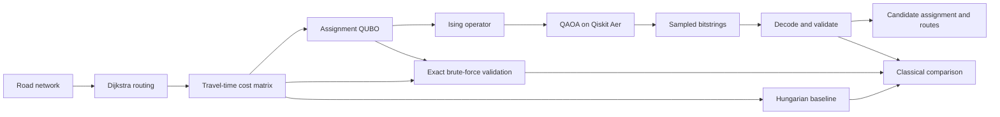

# Architecture

## Data and execution flow

The cost matrix contains severity-weighted Dijkstra travel times for each
ambulance/incident pair. Unreachable pairs are omitted from the QUBO variable
set. The QUBO encodes incident coverage and at-most-one assignment per
ambulance, then maps to an Ising cost operator for QAOA. Sample bitstrings are
decoded and constraint-checked; invalid samples are reported as invalid, not
replaced with a classical assignment.

`prepare(scenario, closure)` constructs the closed network, travel-time
problem, and QUBO without running QAOA. `run_classical(prepared)` executes
exact and Hungarian checks independently. `solve(...)` composes those stages
with QAOA and builds a report. `routes_for(...)` uses the classical road
network to recover routes for any supplied assignment.

The dashboard runs QAOA in a separate worker process so a simulator crash is
reported as a QAOA error instead of taking the server down.

## Responsibility boundaries

| Component | Quantum / simulated quantum role | Classical role |
| --- | --- | --- |
| Road network and routing | None | NetworkX graph, edge closures, Dijkstra travel times and routes |
| Assignment formulation | None | Cost matrix, constraints, QUBO construction and Ising conversion |
| Variational optimization | QAOA circuit and expectation evaluation on Aer | COBYLA parameter optimization and seeded orchestration |
| Sampling | Aer simulator samples the parameterized circuit | Decode bitstrings, calculate sample statistics and validate constraints |
| Validation and baseline | None | Exact QUBO enumeration and SciPy Hungarian assignment |
| Display | None | CLI and Streamlit present results and limitations |

Aer is a classical simulator. The exact and Hungarian outputs are independent
classical reference results, not a silent substitute if the quantum simulation
errors or yields no valid sample.
